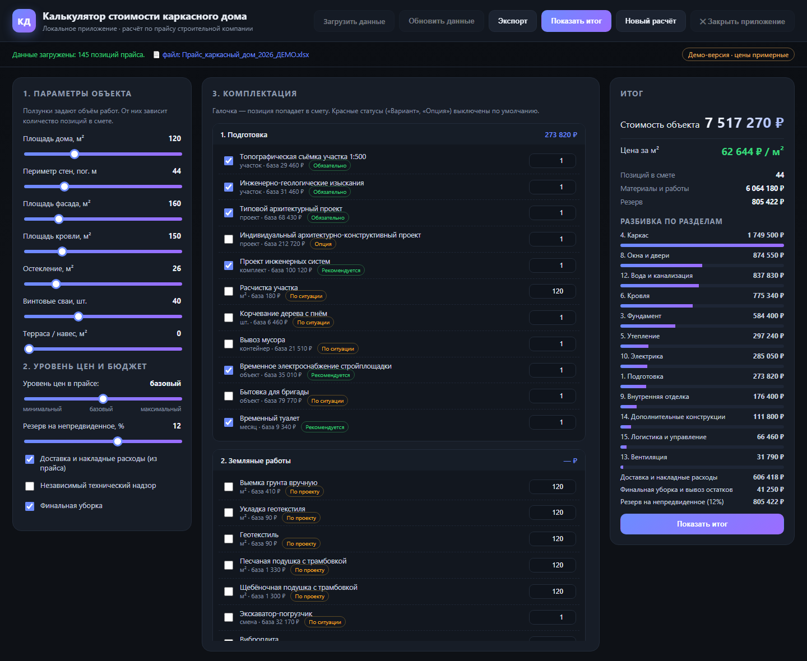
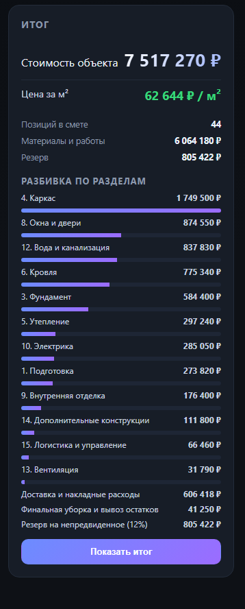
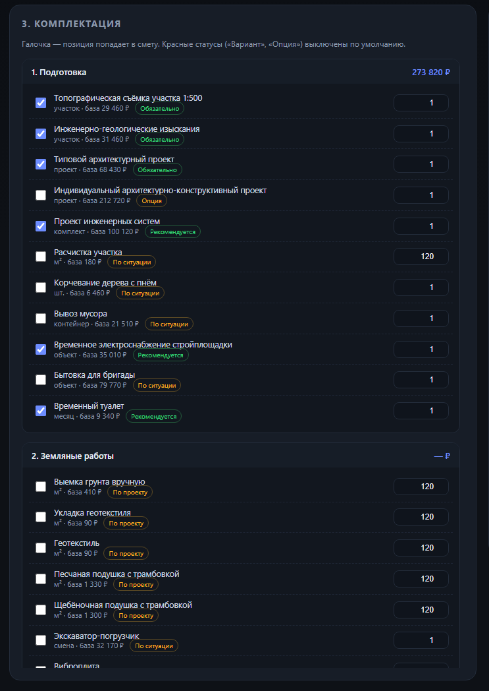

# Калькулятор стоимости каркасного дома

> Менеджер строительной компании за минуту считает стоимость дома по прайсу:
> 145 позиций, 16 разделов, цена за м² и готовая смета для клиента.

### ▶ [Открыть живое демо](https://mary-rnd.github.io/karkas-dom-calculator/)

Работает прямо в браузере, без установки и регистрации.



## Зачем это нужно

Стоимость каркасного дома нельзя посчитать «в голове»: она складывается из
фундамента, каркаса, кровли, окон, инженерии и отделки — это сотни позиций.
Обычно менеджер считает такой дом в Excel два-три часа и всё равно ошибается
в количестве или забывает позицию.

Это приложение превращает прайс компании в простой калькулятор: менеджер
задаёт параметры дома ползунками, отмечает нужные позиции галочками — и сразу
получает стоимость объекта, цену за м² и готовую смету, которую можно отправить
клиенту.

## Возможности

| Возможность | Что это даёт |
|---|---|
| **Прайс из `.xlsx`** | компания продолжает вести цены в привычном Excel — 145 позиций и 16 разделов подхватываются автоматически |
| **Ползунки параметров** | площадь дома, периметр стен, фасад, кровля, остекление, сваи, терраса — объём работ задаётся за секунды |
| **Автоматическое количество** | количество по каждой позиции подставляется по площади, периметру и единицам измерения; при необходимости правится вручную |
| **Три уровня цен** | минимальный, базовый и максимальный уровень из прайса плюс резерв и накладные расходы |
| **Итог и разбивка** | стоимость объекта, цена за м² и диаграмма по разделам |
| **Экспорт сметы** | расчёт выгружается в файл и уходит клиенту |
| **Обновление цен онлайн** | прайс меняется в одном месте (Яндекс.Диск, режим «Просмотр»), а расчёты у всех сотрудников совпадают |

## Как выглядит результат

| Итог по объекту | Смета по разделам |
|:--:|:--:|
| [](docs/screenshots/02-itog.png) | [](docs/screenshots/03-smeta.png) |

## ▶ Живое демо

**<https://mary-rnd.github.io/karkas-dom-calculator/>**

Демонстрационная версия работает целиком в браузере на примерном прайсе:
реальные цены компаний не публикуются, цифры в демо — синтетические.
В демо работают расчёт, ползунки, галочки, экспорт и разбивка по разделам.
Загрузка своего файла и обновление из онлайн-таблицы доступны только
в локальной версии — им нужен локальный сервер.

## Локальная версия

1. Скачайте репозиторий.
2. Запустите `project\запуск.bat` — понадобится Python 3.10+.
3. Приложение откроется по адресу `http://127.0.0.1:8791`
   (порт меняется переменной окружения `KALK_PORT`).

В локальной версии дополнительно работают: загрузка своего `.xlsx`,
обновление цен из онлайн-таблицы по ссылке и закрытие приложения.

### Формат прайса

Первый лист — `Справочник затрат`, первая строка — заголовки:

```
ID | Раздел | Подраздел | Наименование позиции | Тип позиции | Единица измерения |
Минимальная цена, ₽ | Базовая цена, ₽ | Максимальная цена, ₽ | Статус | Основание цены | Комментарий
```

В репозитории лежит обезличенный пример такой таблицы
(`project/Данные/Прайс_каркасный_дом_2026_ОБЕЗЛИЧЕННЫЙ.xlsx`).
Положите свой прайс с такими же колонками — калькулятор посчитает по нему.

## Технологии

- **Python** — только стандартная библиотека: чтение `.xlsx`, локальный сервер
  и расчёт, без сторонних зависимостей.
- **HTML / CSS / JavaScript** — интерфейс и логика расчёта без фреймворков.
- **GitHub Pages** — публичное демо из папки `docs/`.

## Услуга

### Калькулятор стоимости под ключ по вашему прайсу

**от 45 000 ₽ · срок 3–5 рабочих дней · предоплата 50 %**

Вы отдаёте прайс в Excel — получаете готовую программу, которая считает
стоимость по вашим позициям и выдаёт смету клиенту. Без подписок и
конструкторов: программа ваша, ставится на компьютеры сотрудников или
работает в браузере.

| Что входит | Цена |
|---|---:|
| Калькулятор под ключ по вашему прайсу: интерфейс, расчёт, экспорт сметы | 40 000 ₽ |
| Разбор и загрузка вашей таблицы, настройка расчётов по позициям | 8 000 ₽ |
| Сборка `.exe` с иконкой и установка на компьютеры | 5 000 ₽ |
| Публичная онлайн-версия (демо для клиентов) | 5 000 ₽ + 2 000 ₽/год |
| Обучение сотрудников (1 час, онлайн) | 3 000 ₽ |
| Поддержка и обновление прайса | 2 000 ₽/мес |
| Новые опции и доработки после сдачи | 1 500 ₽/ч |

Средний чек «под ключ» с обучением — **55 000 – 65 000 ₽**.

### Почему это столько стоит

Смета каркасного дома — это сотни позиций: фундамент, каркас, кровля, окна,
инженерия, отделка. Вручную менеджер считает такой дом 2–4 часа и всё равно
ошибается в количестве. Программа считает за минуту и без ошибок: один
неверный просчёт в смете стоит дороже, чем вся разработка.

### Условия работы

- Предоплата 50 %, остаток — после демонстрации готовой версии.
- Два круга правок включены в цену, дальше — 1 500 ₽/ч.
- Исходный код передаётся после полной оплаты.
- Прайс с вашими ценами не публикуется и не передаётся третьим лицам.

Подходит: строительные и монтажные компании, ремонт и отделка, натяжные
потолки, электрика, доставка — любой бизнес с прайсом из десятков позиций.

**Связаться:** mar.petrushina@yandex.ru

## Структура репозитория

```
docs/                    публичное демо для GitHub Pages
├─ index.html            интерфейс демо-версии
├─ style.css, app.js     стили и логика калькулятора
├─ demo-data.js          демонстрационный прайс (цены синтетические)
├─ demo.js               подмена серверных вызовов для работы в браузере
└─ screenshots/          изображения для этого README

project/                 локальная версия приложения
├─ server.py             локальный сервер, чтение .xlsx, расчёт, экспорт
├─ index.html, style.css, app.js
├─ запуск.bat            запуск двойным кликом
├─ make_icon.py, app.ico иконка приложения
└─ Данные/               пример прайса
```

Прайс с реальными ценами, оригинальные источники и собранная `.exe`-версия
в репозиторий не входят (см. `.gitignore`).
